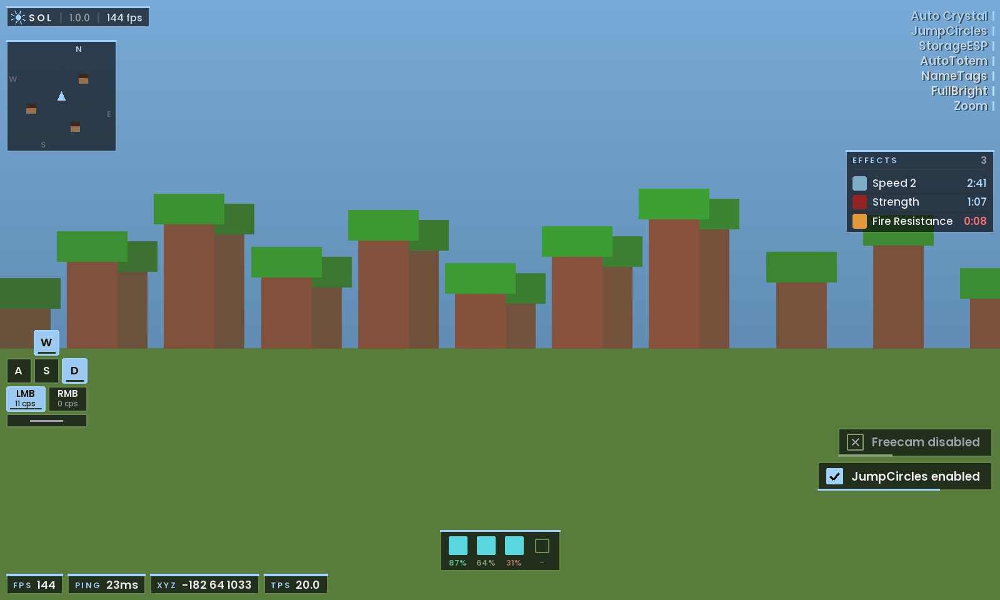

# Sol Client

A Fabric mod for Minecraft 1.21.11.

Based on 67Client. Changed and renamed with the owner's permission.

## Download

Get the jar here: [sol-client-1.0.0.jar](https://github.com/solfain/67client-decompiled/releases/download/latest/sol-client-1.0.0.jar)

Put it in your mods folder with Fabric Loader and Fabric API.

## Menu

Press Right Shift to open it. Modules are cards, sorted into tabs at the top. Left click a card to turn it on or off. Right click it to change its settings. Start typing to search.

The default color is Frost (light blue). Other themes are Sol, Ember, Indigo, Ocean, Mint and Rainbow. There are also two fonts, Poppins and Monocraft.

## HUD

Open chat to move and resize the HUD.

## Jump circles

Three styles: Ripple, Halo and Pulse.

## What changed

* Modules are in new categories.
* Removed CustomAccessories, CustomGlint, the UI sounds and GambleRigger.
* Fixed bugs from the decompiler. For example, every config was saved to the same file, and some chat messages showed "null".
* Old configs will not load.

## Build it yourself

You need JDK 21. Run `./gradlew build`. The jar ends up in `build/libs`.

Every push also builds the jar on GitHub and puts it on the [latest release](https://github.com/solfain/67client-decompiled/releases/tag/latest).

It builds fine but has not been tested in game yet.

## Known problems

AimAssist does nothing. Its code was missing from the original jar.

## Credits

* Original code by the 67Client owner.
* Fonts: Poppins and Monocraft (SIL Open Font License).
* Icons: Lawnicons.
