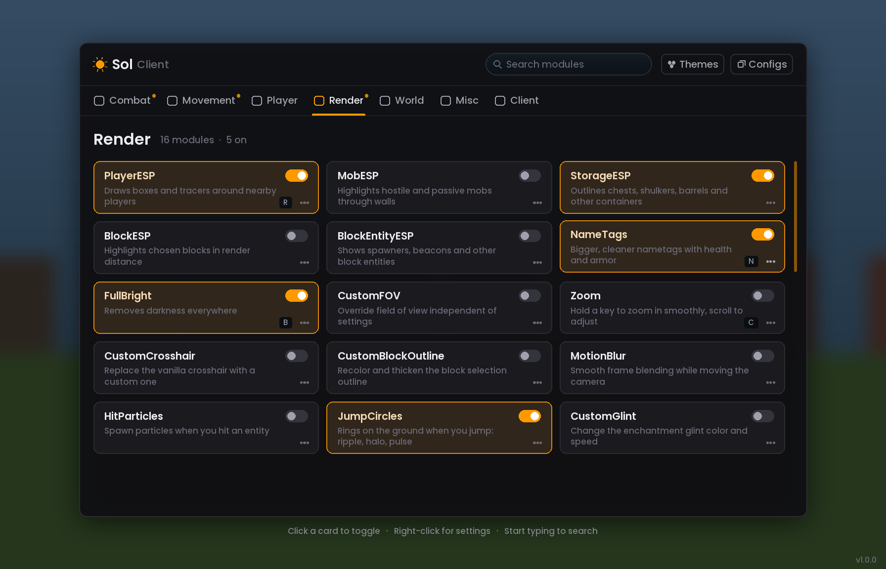

# Sol Client

A Fabric client mod for **Minecraft 1.21.11**: a NanoVG ClickGUI, HUD editor, themes and modules.

> Based on **67Client**, modified and rebranded with the original author's permission.



*(This preview is a mockup drawn with the same sizes, colours and font as the code. It's not a real screenshot.)*

## The UI

One centred window. No sidebar and no floating panels.

- **Top row**: the Sol logo, a search box, and **Themes** / **Configs** buttons. Start typing anywhere to search every category at once.
- **Category tabs**: Combat, Movement, Player, Render, World, Misc and Client, with icons and a sliding accent underline. A dot on a tab means something in it is enabled. ←/→ or Tab switches categories.
- **Module cards** in a responsive grid. Each card shows the name, a short description, an on/off switch and the keybind (if one is set). Enabled cards get an accent outline and tint.
  Left-click a card to toggle it. Right-click it (or click the `···`) to open its settings window.
- **Themes view**: accent swatches for Sol (default orange), Ember, Indigo, Ocean, Mint, Frost and Rainbow, plus custom accents with a colour picker.
- **Fonts**: Poppins by default ("Clean"). You can switch to Monocraft ("Pixel") in ClickGUI → Font.
- **HUD**: sun watermark, a flat module list with a thin accent edge, and flat info pills.

## Jump circles

Three styles to choose from: **Ripple** (expanding rings), **Halo** (a spinning glow ring) and **Pulse** (a quick flash ring).
Settings: size, colour or rainbow, lifetime, ring count, spin, sparks and a maximum number on screen.

## Changes from the original

- Modules have been re-sorted into new categories, alphabetical within each one.
- Removed: CustomAccessories, CustomGlint (and its glint textures), the client UI sound system, and the Fabric gametest suite. GambleRigger is not included.
- Fixed decompiler bugs: switches on undefined variables in AutoClicker, AutoWalk, CoordSnapper, CustomCrosshair, FakeRoles and StaffDetector, plus an AutoClicker loop that could freeze the game.
- Configs are now keyed `Name@CATEGORY`, so **configs from the old client won't carry over**.

## Building

```bash
./gradlew build          # output: build/libs/sol-client-1.0.0.jar
```

Requires JDK 21. The sources came from a decompiled jar, so they use **intermediary** names
(`class_310`, `method_1551`, …). `build.gradle` uses intermediary as its mappings so they compile as-is.
This hasn't been compiled yet. The first build will likely turn up a few decompiler artifacts and API mismatches that need hand-fixing.

## Layout

```
src/main/java/dev/sol/          mod source (package dev.sol, entrypoint SolClient)
src/main/resources/             fabric.mod.json, solclient.mixins.json, assets/solclient/
```

## Credits

- Original code: the **67Client** author. Used and modified with their permission.
- Fonts: [Poppins](src/main/resources/assets/solclient/fonts/Poppins-OFL.txt) and [Monocraft](src/main/resources/assets/solclient/fonts/Monocraft-OFL.txt), both under the SIL Open Font License.
- Category icons: Lawnicons (see `assets/solclient/icons/LICENSE-lawnicons.txt`).

## Known gaps

- **AimAssist's logic is missing.** The original shipped it as an encrypted class (`dev.sol.secured.AimAssistLogic`). That class isn't in the dump, so the module loads but does nothing.
